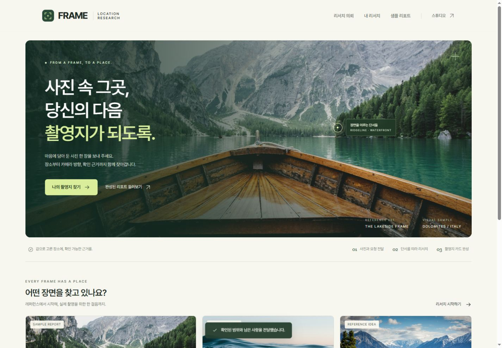

# FRAME · 사진에서 시작하는 촬영지 리서치

**사진 속 장소를 조사하고, 촬영 위치·방향·판단 근거를 검토 가능한 리포트로 연결하는 프로젝트입니다.**

오픈소스 **geo-sleuth**의 조사 절차를 분석하고 실제 사진으로 검증한 뒤, 이를 사용자가 의뢰하고 결과를 확인할 수 있는 **FRAME 로컬 웹 프로토타입**으로 연결했습니다. 이 저장소에는 서비스 코드, 기획, 조사 원본, 검증 기록, 발표자료를 함께 정리했습니다.

> **현재 단계 · 2026.11.04 기준**
>
> 로컬 실시간 조사 프로토타입 구현 및 사례 검증 진행 중입니다. 외부 공개 서비스 운영과 일반적인 위치 정확도 검증은 앞으로의 과제입니다.



*촬영지 리서치 서비스의 화면 예시입니다. 화면의 샘플 리포트와 실제 조사 결과는 구분됩니다.*

## 프로젝트 목표

GPS나 지명이 없는 사진도 건물·지형·시설 같은 단서를 공개 자료와 대조하면 촬영 구역을 좁힐 수 있습니다. 하지만 좌표만 제시하면 **왜 그 장소인지, 어디까지 확인됐는지** 판단하기 어렵습니다.

이 프로젝트는 다음 세 가지를 목표로 합니다.

1. **근거가 남는 위치 조사** — 사진·지도·거리사진·계산 결과를 연결해 판단 과정을 확인할 수 있게 합니다.
2. **조사 절차의 서비스화** — 사진 접수부터 실제 조사, 진행 기록, 결과 검토까지 하나의 흐름으로 제공합니다.
3. **불확실성의 명확한 전달** — 장소 대표점과 카메라 추정점을 구분하고, 미확정 결과와 추가 확인 사항을 표시합니다.

주요 사용자는 레퍼런스 사진으로 촬영지를 찾거나 답사를 준비하는 사진가·영상 제작자입니다. 유료 수요와 기존 이미지 검색 대비 가치는 아직 검증할 가설입니다.

## 저장소 구성

```text
geo-project/
├── apps/frame/          FRAME 웹 화면·로컬 서버·조사 실행기·테스트
├── docs/                서비스 기획·기술 구조·진행 현황·포트폴리오 메모
├── research/
│   ├── cases/           geo-sleuth 조사·재검증 7개 작업 폴더
│   ├── datasets/        테스트 사진·출처·정답표
│   └── frame-runs/      FRAME 실제 조사 5건의 결과·근거·중간 산출물
├── presentations/       최신 발표자료·이전 버전·제작 코드·검사 기록
└── vendor/geo-sleuth/   분석에 사용한 원본 오픈소스 스냅샷
```

| 찾는 내용 | 바로 보기 |
|---|---|
| 어떤 서비스를 만들고 있는가 | [FRAME 서비스 기획](docs/frame-plan.md) |
| 어떻게 동작하는가 | [기술 구조와 데이터 흐름](docs/architecture.md) |
| geo-sleuth는 무엇인가 | [조사 절차·기술·입출력 정리](docs/geo-sleuth.md) |
| 실제 사진에서 무엇을 확인했는가 | [사례와 검증 결과](research/README.md) |
| 어디까지 구현됐는가 | [진행 현황과 다음 과제](docs/status.md) |
| 이력서에 어떻게 설명할 수 있는가 | [포트폴리오 작성 메모](docs/portfolio-notes.md) |
| 발표자료를 보고 싶다 | [최신 자료와 버전 안내](presentations/README.md) |

## 현재 구현한 것

| 영역 | 현재 상태 |
|---|---|
| 서비스 화면 | 사진 의뢰, 내 리서치, 실시간 기록, 리포트, 수동 편집 스튜디오 구현 |
| 실제 조사 연결 | 로컬 서버 → Codex CLI → geo-sleuth → 구조화된 결과·근거 이미지 연결 |
| 진행·작업 관리 | SSE 진행 기록, 1건씩 처리하는 대기열, 중지, 디스크 저장·복원 |
| 결과 품질 검사 | 좌표 의미·단계별 검증·이미지 해독·빈 JSON·실패한 지도 타일 검사 |
| 실행 안정화 | 네트워크 사전 점검, 오류 분류, 제한 재시도, 체크포인트와 중간 자료 이어받기 |
| 한국 지역팩 | 주소·동명 장소·로드뷰·좌표계 해석 등 최소 한국 자료팩 연결 |
| 사례·발표 | geo-sleuth 작업 7개, FRAME 실제 조사 5건 보관, 발표자료 13개 버전 정리 |
| 서비스 운영·평가 | 다중 사용자 운영, 결제, 고객 검증, 독립 평가셋 기반 정확도 측정은 미구현·미검증 |

FRAME의 실제 조사 5건은 작업 실행이 완료된 기록이며, 현재 모두 **추가 확인(`review`)** 상태입니다. 완료된 실행 횟수가 정답이나 정밀 촬영점의 확정 횟수를 뜻하지는 않습니다.

## geo-sleuth와 FRAME의 관계

**[geo-sleuth](https://github.com/Oldcircle/geo-sleuth)**는 사진 위치 조사를 위한 에이전트 스킬과 Python 도구 모음입니다. AI 에이전트가 단서를 해석하고 도구를 선택하며, 프로그램이 자료 조회·이미지 비교·기하 계산을 수행합니다.

```text
사진·요청 → 단서 확인 → 후보 조사 → 공개 사진·지도·지형 대조
        → 위치·방향 검증 → 근거 이미지·구조화된 결과 → FRAME 리포트
```

이 프로젝트의 작업 범위는 **기존 스킬 분석, 실제 사례 실험, 검증의 한계 정리, FRAME 서비스 기획·연동·운영 기능 구현**입니다. geo-sleuth 원본이나 DINOv2 같은 기반 모델을 새로 개발·학습한 프로젝트로 설명하지 않습니다. 구현과 분석에는 AI 코딩·조사 도구를 활용했습니다.

## 대표 검증 사례

**강릉 사근진해중공원 야간 사진 재검증**에서는 사진·지도 대응점과 높이 가정으로 카메라 위치를 계산하고, 점 제외 검사·높이 변경·좌표 변동·해안선 대조를 수행했습니다.

- 조건부 계산점과 사용자가 제공한 실제 좌표의 거리: **4.65m**
- 높이 가정을 바꾼 **81개 조건**에서 위치가 최대 약 **25m** 이동
- 같은 사진과 실제 위치를 이전에 알고 있었던 재검증으로, 독립 블라인드 테스트가 아님
- 결론: 시설과 촬영 구역은 지지되지만 **정밀 촬영점과 검증된 오차반경은 미확정**

이 사례는 ‘항상 5m 정확도’라는 성과보다, **계산값이 가까워도 입력 조건과 독립 검증을 확인해야 한다는 점**을 보여줍니다. [한국어 보고서](research/cases/geo_work_20261103_precision/report_ko.md) · [수치 비교](research/cases/geo_work_20261103_precision/coordinate_comparison.json)

다른 사례에는 독산성, 오다이바, 도쿄 시바우라, 제주 사계해안, 사근진 초기 조사, 위치를 확정하지 못한 주택 사진이 포함됩니다. [전체 사례](research/README.md)

## 실행과 확인

Node.js 18 이상, Python 3.10 이상, `uv`, 로그인된 Codex CLI가 필요합니다. 다음은 저장소 루트에서 실행하는 PowerShell 예시입니다.

```powershell
cd apps/frame
$env:FRAME_GEO_SKILL = (Resolve-Path ../../vendor/geo-sleuth/skills/geo-sleuth).Path
npm run dev
```

[http://localhost:4173](http://localhost:4173)에서 확인할 수 있습니다. Node 패키지 추가 설치는 필요하지 않으며, 개별 조사 도구는 최초 사용 시 Python 의존성·모델 파일을 내려받을 수 있습니다. 실제 조사에는 로그인한 계정의 모델 사용량과 외부 데이터 서비스가 사용됩니다.

```powershell
npm run check
npm test
```

실행 조건과 환경 변수는 [앱 원본 안내](apps/frame/README.md), 이번 정리 시점의 검사 결과는 [검증 기록](docs/validation.md)을 참고하세요. 테스트는 전용 자식 프로세스와 로컬 HTTP 서버를 사용하며 실제 위치 추정 정확도를 평가하지는 않습니다.

## 다음 과제

1. 정답을 보지 않은 새 사진으로 위치 오차·보류율·시간·비용을 평가합니다.
2. 근거리 기준점과 촬영 조건을 확보해 카메라 위치 검증을 보강합니다.
3. 제작자 사용성 검토로 리포트가 실제 답사 준비에 도움이 되는지 확인합니다.
4. 외부 서비스화에 필요한 인증·사용자별 작업 격리·업로드 관리·비용 통제를 설계합니다.

## 출처와 자료 보관

geo-sleuth는 **Oldcircle의 MIT 라이선스 오픈소스**이며 [원본 LICENSE](vendor/geo-sleuth/LICENSE)와 사용한 커밋을 보존했습니다. 사진·지도·글꼴에는 각 출처의 조건이 적용됩니다. [출처·권리 구분](THIRD_PARTY_NOTICES.md)

작업 원본은 별도 복사해 보관했습니다. 모델 가중치·의존성 캐시·인증정보·원시 대화 로그·중복 렌더 등은 제외하고, 포함 범위와 원본 파일 해시는 [자료 정리 기준](docs/archive-policy.md)과 [수집 목록](docs/archive-manifest.json)에 기록했습니다. 기존 산출물의 `geo-slueth` 오타는 원본 파일명에 남겨 두고, 설명에서는 `geo-sleuth`로 통일했습니다.
