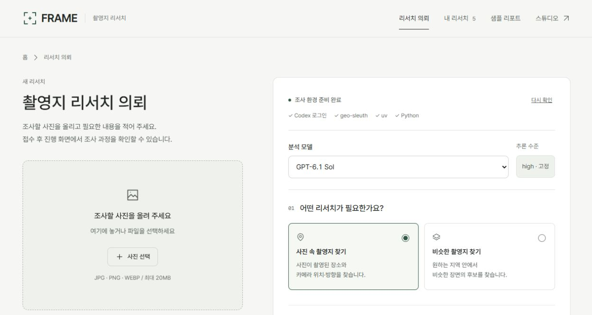
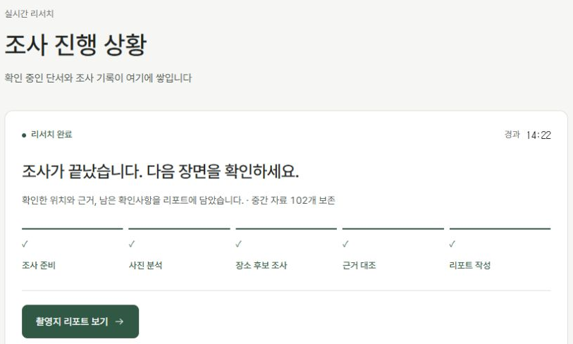
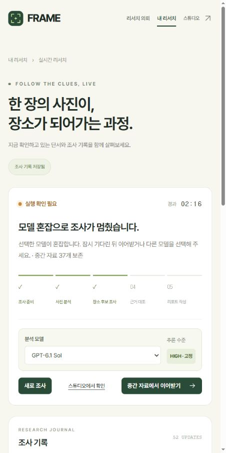
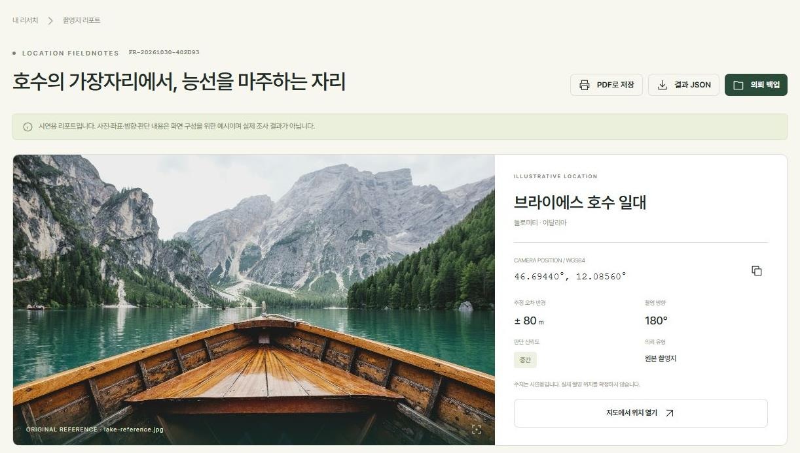
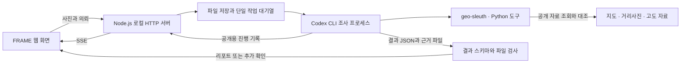

# FRAME · 사진에서 시작하는 촬영지 리서치

**레퍼런스 사진 한 장으로 촬영 후보를 찾고, 위치·방향·판단 근거를 리포트에서 검토하는 로컬 웹 프로토타입입니다.**


## Service Overview

사진가나 영상 제작자가 레퍼런스와 비슷한 장면을 촬영하려면 장소 이름뿐 아니라 **카메라가 어디에 있었는지, 어느 방향을 바라봤는지, 어떤 근거로 판단했는지**가 필요합니다. FRAME은 사진과 요청을 접수하고, 조사 진행 상황을 보여 준 뒤, 결과와 추가 확인이 필요한 항목을 하나의 리포트로 정리합니다. [서비스 기획](docs/frame-plan.md)

이 프로젝트는 [Oldcircle의 geo-sleuth](https://github.com/Oldcircle/geo-sleuth) 조사 절차를 실제 사례로 검토하고 웹 앱에서 실행할 수 있도록 연결했습니다. FRAME은 접수·대기열·복구·결과 검증·리포트를 맡고, Codex CLI와 geo-sleuth는 사진 단서 해석과 공개 자료 대조를 맡습니다. 현재는 개인 PC에서 실행하는 시연·검증 단계입니다. [geo-sleuth 분석](docs/geo-sleuth.md) · [진행 현황](docs/status.md)

## Tech Stack

| 영역 | 기술과 역할 |
| --- | --- |
| 웹 UI | HTML, CSS, JavaScript ES Modules로 의뢰·진행·리포트·스튜디오 구현 |
| 로컬 서버 | Node.js 내장 HTTP 서버, Server-Sent Events(SSE) |
| 조사 실행 | Codex CLI 자식 프로세스, geo-sleuth 스킬, Python, uv |
| 원본 조사 도구 | EXIF·OCR, DINOv2·SIFT 기반 후보 비교, 공개 지도·거리사진·고도 자료 |
| 결과와 저장 | JSON Schema 결과, 의뢰별 파일 저장, Python·Pillow 근거 이미지 검사 |
| 테스트 | Node.js 테스트 러너, Python unittest, 모의 CLI 및 로컬 HTTP 응답 |

## Key Features

### 사진으로 리서치 의뢰

사진을 올리고 원본 촬영지 또는 비슷한 장면의 후보를 요청합니다. 찾을 지역·촬영 목적·확인할 조건을 함께 적을 수 있고, 제출 전에 로컬 실행 환경을 확인합니다. [앱 사용법](apps/frame/README.md)



### 실시간 진행 기록과 중단된 조사 복구

조사 준비, 사진 분석, 후보 조사, 근거 대조, 리포트 작성 단계를 실시간으로 보여 줍니다. 서버에 작업 기록을 저장해 브라우저를 다시 열어도 이어서 볼 수 있습니다. 작업을 멈췄거나 실행 오류가 발생하면 새로 조사하거나 보존된 중간 자료에서 이어갈 수 있습니다. [작업 관리 코드](apps/frame/lib/jobs.mjs) · [복구 코드](apps/frame/lib/recovery.mjs)



*실제 조사 기록의 진행 화면입니다. 화면의 ‘리서치 완료’는 조사 실행이 끝났음을 나타냅니다.*

<details>
<summary>모델 혼잡 시 이어받기 화면</summary>
<br>

</details>

### 근거를 검토할 수 있는 촬영지 리포트

장소 대표점과 카메라 추정점을 구분하고, 위치 추정 반경·촬영 방위각·수평 시야각과 그 근거를 항목별로 보여 줍니다. 리포트에서 비교 이미지와 출처를 열어 보고, 스튜디오에서 추가 근거와 판단을 보완할 수 있습니다. 결과 JSON·PDF와 의뢰 백업을 제공합니다. [리포트 구성 코드](apps/frame/dist/lib/research-report.js) · [실제 조사 기록](research/frame-runs/README.md)



*화면 구성용 샘플 리포트입니다. 사진·좌표·방향 수치는 시연용입니다.* [전체 화면](docs/assets/frame-report.jpg) · [샘플 사진 출처](apps/frame/ASSETS.md)

## System Architecture



서버는 조사 작업을 한 번에 한 건씩 실행합니다. 조사 중에는 공개용 상태를 SSE로 보내고, 종료 뒤에는 좌표의 의미와 근거 파일을 검사해 리포트 상태를 정합니다. 의뢰별 원본·중간 자료·최종 결과는 로컬 디스크에 저장합니다. [구조와 데이터 계약](docs/architecture.md) · [서버 코드](apps/frame/server.mjs)

## Challenges & Solutions

### 1. 좌표 하나로는 어디까지 확인됐는지 알기 어렵다

시설 대표점·지역 참고점·카메라 추정점을 별도 유형으로 저장하고, 도시·지역·도로·촬영점별 신뢰도를 분리했습니다. 정밀 위치나 근거가 부족하면 리포트에 **추가 확인** 상태를 표시합니다. 공개본에 보관한 실제 FRAME 실행 5건은 조사가 끝났고 결과는 모두 추가 확인 상태입니다. [결과 검증 코드](apps/frame/lib/quality.mjs) · [실행별 기록](research/frame-runs/README.md)

### 2. 파일이 생겨도 실제로 쓸 수 있는 근거인지 확인해야 한다

다운로드 오류가 HTML을 이미지 파일로 저장하거나, 타일을 불러오지 못한 빈 지도가 결과로 남을 수 있었습니다. 이미지 해독, 빈 JSON, 지도 크기·실패 타일을 검사하고, 리포트의 검증 기록을 실제 조사 도구 실행 및 근거 파일과 대조했습니다. [근거 파일 검사](apps/frame/lib/assets.mjs) · [검증 기록](docs/validation.md)

### 3. 긴 조사가 일시 오류로 멈추면 수집한 자료가 유실될 수 있다

Windows HTTPS 전송 오류를 조사 실행 범위에서 보완하고, 모델 혼잡에는 같은 모델에서 최대 두 번 재시도하도록 제한했습니다. 복구할 때는 체크포인트와 허용된 중간 자료를 넘기고, 새 시도에서 결과를 다시 검증합니다. [실행기](apps/frame/lib/worker.mjs) · [통신과 복구 설계](docs/architecture.md)

## Case Study · 사근진해중공원 야간 사진

사진과 지도에서 대응점을 잡고 높이 가정을 바꿔 카메라 위치를 비교했습니다. 조건부 계산점은 사용자 제공 좌표에서 **4.65m** 떨어졌고, **81개 높이 조건**에서는 최대 약 **25m** 이동했습니다. 위치를 이미 알고 진행한 재검증이므로, 시설과 촬영 구역을 지지하는 근거까지 기록하고 정밀 촬영점과 검증된 오차 반경은 미확정으로 남겼습니다. [사례 보고서](research/cases/geo_work_20261103_precision/report_ko.md) · [비교 수치](research/cases/geo_work_20261103_precision/coordinate_comparison.json) · [전체 조사 사례](research/README.md)

## Getting Started

Node.js 18 이상, Python 3.10 이상, `uv`, 로그인된 Codex CLI가 필요합니다. 저장소 루트에서 아래 명령을 실행한 뒤 [localhost:4173](http://localhost:4173)에서 확인합니다.

```powershell
cd apps/frame
$env:FRAME_GEO_SKILL = (Resolve-Path ../../vendor/geo-sleuth/skills/geo-sleuth).Path
npm run dev
```

별도 Node 패키지 설치는 필요하지 않습니다. 실제 조사를 시작하면 Codex 계정의 모델 사용량과 외부 데이터 서비스가 사용되고, 일부 조사 도구는 처음 실행할 때 Python 의존성과 모델 파일을 내려받습니다. [실행 환경과 설정](apps/frame/README.md)

```powershell
npm run check
npm test
```

저장소 정리 시점에 Node 테스트 21개와 Python 테스트 7개를 통과했습니다. 모의 CLI와 로컬 HTTP 응답을 사용해 작업 관리·SSE·결과 파일·전송 처리를 점검했습니다. 위치 판단의 근거와 한계는 사례별 기록에 정리했습니다. [자동 테스트 범위](docs/validation.md)

## Repository Guide

| 경로 | 내용 |
| --- | --- |
| [apps/frame/](apps/frame/) | FRAME 화면, 로컬 서버, 실행기, 테스트, 한국 지역팩 |
| [docs/](docs/) | 서비스 기획, 기술 구조, 진행 현황, [자료 정리 기준](docs/archive-policy.md) |
| [research/](research/README.md) | 연구·재검증 작업 7개, 테스트 사진 출처, 실제 FRAME 실행 5건 |
| [presentations/](presentations/README.md) | 사례 발표 자료와 이전 버전 |
| [vendor/geo-sleuth/](vendor/geo-sleuth/) | 조사에 사용한 업스트림 원본 스냅샷 |

## License & Attribution

Oldcircle의 geo-sleuth 원본 코드와 스킬은 **MIT**입니다. 일부 조회 데이터는 별도 출처 조건을 따릅니다. FRAME 자체 코드에는 별도 라이선스가 명시되어 있지 않으며, 한국 지역팩의 `services.md`는 작성 텍스트에 **CC0 1.0**을 표시합니다. 글꼴·사진·지도에는 각 출처의 조건이 적용됩니다. [geo-sleuth MIT 원문](vendor/geo-sleuth/LICENSE) · [조회 데이터 출처](vendor/geo-sleuth/skills/geo-sleuth/data/README.md) · [한국 지역팩 출처](apps/frame/region-packs/kr/services.md#provenance) · [제3자 소프트웨어와 자산 고지](THIRD_PARTY_NOTICES.md)
