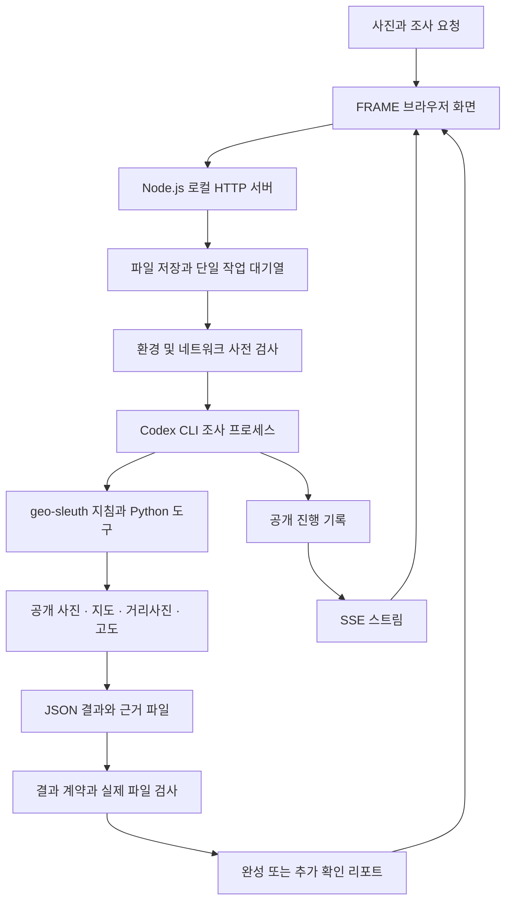

# 기술 구조와 데이터 흐름

## 전체 구조

웹 화면은 HTML·CSS·JavaScript ES 모듈로 구성한다. 서버는 Node.js 기본 기능을 사용하며 Node 외부 패키지 설치 없이 실행한다. `dist/`는 이 앱의 실제 배포 화면 소스이므로 저장소에 포함했다.

## 주요 코드

| 파일 | 담당 기능 |
|---|---|
| [server.mjs](../apps/frame/server.mjs) | 정적 화면, 접수·조사·파일 API, SSE 연결 |
| [lib/jobs.mjs](../apps/frame/lib/jobs.mjs) | 의뢰 저장, 대기열, 실행·중지, 결과 연결 |
| [lib/runtime.mjs](../apps/frame/lib/runtime.mjs) | CLI 탐색·인자·실행 환경, 결과 JSON Schema, 이벤트 변환 |
| [lib/worker.mjs](../apps/frame/lib/worker.mjs) | 실제 조사 프로세스, 제한 재시도·세션 복구 |
| [lib/recovery.mjs](../apps/frame/lib/recovery.mjs) | 체크포인트·중간 자료 보존과 이어받기 |
| [lib/quality.mjs](../apps/frame/lib/quality.mjs) | 실제 도구 실행과 보고서 검증 조건 대조 |
| [lib/assets.mjs](../apps/frame/lib/assets.mjs) | 근거 파일·이미지·지도 자료의 유효성 검사 |
| [lib/tooling.mjs](../apps/frame/lib/tooling.mjs) | 설치된 도구 목록과 실행기 구성 |
| [lib/errors.mjs](../apps/frame/lib/errors.mjs) | 모델·네트워크·자료·실행 오류의 분류 |
| [tools/python/frame_https.py](../apps/frame/tools/python/frame_https.py) | worker 내부 Python HTTPS 전송 어댑터 |
| [dist/lib/domain.js](../apps/frame/dist/lib/domain.js) | 결과 정규화·좌표·백업 등 화면 데이터 계약 |
| [dist/lib/research-report.js](../apps/frame/dist/lib/research-report.js) | 위치·반경·방위·화각·근거의 리포트 표현 |

## 결과 계약

주요 결과는 `place_name`, `lat/lon`, `radius_m`, `heading`, `hfov`, `coordinate_type`, `confidence_levels`, `verification`, `sources`, `evidence`, `map_image` 등이다. 정확한 필드·선택 여부는 `REPORT_SCHEMA`와 도메인 코드를 기준으로 한다.

- **좌표 의미:** 시설 대표점, 지역 참고점, 카메라 추정점을 구분한다.
- **반경:** 보고 범위와 검증된 카메라 오차를 혼동하지 않도록 근거를 함께 받는다.
- **방위와 화각:** 카메라가 향한 방향과 화면에 담기는 각도를 별도 표시한다.
- **신뢰도:** 도시·지역·도로·촬영점 수준을 구분한다.
- **검증:** 실제 실행과 참조 파일을 대조한다. 도움말·소스 열람·도구 실패는 검증 성공으로 세지 않는다.

구조와 실행의 검사만으로 사진 대조의 의미적 정확성을 증명할 수는 없다. 이 한계는 추가 확인 상태와 함께 표시한다.

## 실행과 복구

기본 동시 실행은 1건, 제한은 15분이다. 새 의뢰는 대기열에서 기다린다. 모델 선택은 의뢰·시도별로 기록하고 추론 수준은 현재 코드에서 `high`로 설정한다. 기존 결과의 실행 설정을 최신 기본값으로 덮어쓰지 않는다.

모델 혼잡은 같은 모델로 15초·45초 뒤 최대 두 번 재시도한다. 전체 제한 시간 안에서만 동작한다. 세션을 이어받을 수 없으면 확인된 중간 자료를 새 세션에 연결한다. 사용자 동작인 **새로 조사**와 **중간 자료에서 이어받기**도 구분한다. 다른 모델로 자동 대체하지 않는다.

이어받기에는 파일 수·용량·깊이 제한이 있으며 실행 코드·심볼릭 링크·원시 대화 로그는 넘기지 않는다. 이전 검증 통과 상태도 자동 상속하지 않는다.

## 통신·자료 검사

Windows curl의 Schannel 오류를 Python HTTPS와 비교해 확인한 뒤, worker 환경에만 전송 어댑터를 적용했다. TLS 인증서 검증을 유지하며 전역 geo-sleuth 소스는 수정하지 않는다. 브라우저 업로드와 ML 라이브러리의 자체 통신까지 모두 바꾸는 어댑터는 아니다.

파일이 생성됐는지만 검사하지 않는다. 이미지 실제 해독, HTML 위장 응답, 빈 JSON, 지도 크기와 실패 타일 수를 확인한다. 실패한 타일로 만들어진 검은 지도는 정상 근거로 인정하지 않는다.

## 저장·노출 범위

운영 데이터는 `.local-data/requests/<id>/`에 저장한다. 웹 API는 등록되고 검사한 파일을 제공하며 원시 대화·stderr 로그는 공개하지 않는다. 브라우저를 닫아도 서버가 살아 있으면 조사는 계속되고, 다시 접속하면 기록을 복원한다.

현재 서버는 `127.0.0.1` 전용이다. 사용자 인증, 테넌트별 격리, 외부 공개 작업 실행 환경, 서비스용 완전 삭제는 아직 구현하지 않았다.
