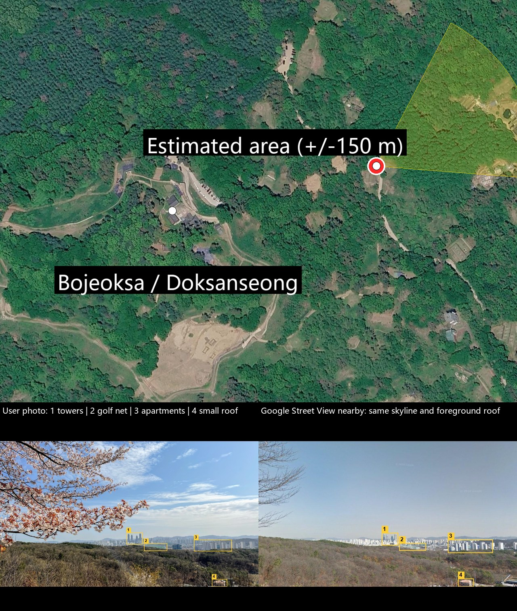

# Geolocation report

사진은 **경기도 오산시 독산성·보적사 북동쪽 진입로 주변에서 동북동쪽 동탄을 바라보고 촬영한 것**으로 판단한다.

- 대표 좌표: WGS84 **37.1843, 127.0223**
- 위치 오차 범위: 대략 반경 **150m**. 통계적 신뢰구간이나 정확한 촬영점 측정값은 아니다.
- 촬영 방향: 진북 기준 약 **61°**, 동북동.
- 좌표는 가장 잘 맞는 공개 거리사진 주변의 대표점이며, 서로 다른 후보를 평균 낸 점이 아니다.

## Evidence

1. 사진 중앙의 네 고층 건물은 동탄 메타폴리스의 높이 순서, 탑 부분의 형태와 대응한다. 독산성에서 촬영한 공개 사진에서도 같은 건물군을 확인했다.
2. 타워 오른쪽의 초록색 골프연습장 망과 그 오른쪽 아파트군의 순서·상대 배치가 독산성 북동쪽 진입로 거리사진과 맞는다.
3. 최상위 거리사진에는 사용자 사진 오른쪽 아래의 작은 지붕과 대응하는 구조물도 있다. 먼 스카이라인뿐 아니라 가까운 지형도 이 도로 주변을 지지한다. 수목과 시점 차이 때문에 정확한 나무나 발 디딘 자리는 확정하지 않았다.
4. 후보 위치의 지표 고도는 공개 지형 조회에서 약124m였다. 눈높이1.6m를 더하고 타워 좌표·지붕 높이를 투영하면 관측한 지붕 위치와 약0.81픽셀 RMS로 맞는다. 단, 후보 위치를 고정한 일관성 검사이며 독립적인 위치 결정 결과가 아니다. 네 타워만 사용한 자유 위치 추정은 거의 일직선인 배치 때문에 불안정하여 채택하지 않았다.

## Confidence

| 범위 | 신뢰도 | 해석 |
|---|---|---|
| 오산시 | 높음 | 고유한 건물군 및 공개 조망 사진 대응 |
| 독산성·보적사 주변 | 높음 | 스카이라인·시설·지형이 함께 일치 |
| 북동쪽 진입로 구간 | 중간 | 공개 거리사진과 여러 구조물 대응, 인접 지점 가능 |
| 정확한 촬영 자리 | 낮음 | GPS와 가까운 고정 기준점의 정밀 측정 부족 |

## Sources

- [가장 잘 맞는 공개 Google Street View 지점](https://www.google.com/maps/@?api=1&map_action=pano&pano=JLn8Mh9EZ02Qha_FQYGYdg&heading=61&pitch=8&fov=67)
- [독산성 공개 조망 사진](https://taijung.tistory.com/159)
- [경기문화재단 독산성 관련 사진·글](https://ggc.ggcf.kr/p/654ad78777e5f81f54e4a703)
- [대표 좌표 지도](https://www.google.com/maps/search/?api=1&query=37.1843,127.0223)

## Reproducible checks

명령은 geo-sleuth의 scripts 폴더에서 `uv run`으로 실행했다. 실제 산출물을 같은 조사 폴더에 보관했다.

| 검증 | 실행한 도구·핵심 인자 | 산출물 |
|---|---|---|
| 메타데이터·OCR·가장자리 확인 | `intake.py` | `intake/intake.md`, `edges_sheet.jpg` |
| 공개 조망 사진24개 순위화 | `match.py rank --query-box 450,490,1440,660 --refine sift` | `matches.json`, `matches.jpg` |
| 시설 좌표 및 상대 수평각 비교 | `osm.py geom`, `tiles.py fetch`, 로컬 `geometry_scan.py` | `metapolis.geojson`, `horizontal_scan.json` |
| 인접 거리사진20개 순위화 | `match.py rank --items road.index.json --render gsv --refine sift` | `road_matches.json`, `road_matches.jpg` |
| 순위 상위 사진과 뒤쪽 시야 확인 | `gsv.py render` | `street_top.jpg`, `street_second.jpg`, `street_reverse.jpg` |
| 지표 고도 | `terrain.py elev --at 37.18428,127.02232` | 실행 결과124m; `final_pose.json`에 반영 |
| 후보 위치의 지붕 재투영 | `pose.py project --pose final_pose.json --points final_points.json` | `pose_selfcheck.jpg`, `final_pose.json` |
| 최종 증거 이미지·후보 점검 | `evidence.py evidence_spec.json`, `board.py check`, `board.py report --merge result.json` | `evidence.jpg`, `board.json`, `result.json` |

거리사진 자동 비교의 최상위 결과는 SIFT 인라이어0개였다. 따라서 자동 점수만으로 동일 지점을 확정하지 않았고, 상위 사진의 지속적인 구조물을 직접 비교했다. 후보 장부 점수도 통계적 확률로 해석하지 않았다.

`pose.py`의 텍스트 수평선 안내에는 실제 투영 함수와 부호가 반대인 수식이 있었다. 사진에 수평인 바다 수평선은 없으므로 해당 안내를 판단 근거로 쓰지 않았다. 실제 `project` 함수가 산출한 건물 위치를 사용했고 이 제한을 `final_pose.json`에 기록했다.

## Alternatives and limitations

- 양산봉도 처음에는 후보였지만, 타워와 초록색 망의 상대 배치가 독산성 북동쪽 시야에 더 잘 맞았다. 공식적으로 완전히 배제한 것은 아니다.
- 같은 진입로의 북쪽 굽이와 남쪽 접근 구간은 나무·전봇대·근거리 지형의 배치가 덜 맞았다. 대표점 인근의 다른 촬영 위치는 여전히 가능하다.
- 다른 지역의 동명 장소는 스카이라인 근거가 없었으며 현장 거리사진을 광범위하게 조사하지 않았다.
- GPS EXIF 및 읽을 수 있는 표지가 없었다. 꽃의 모양과 파일명은 정확한 위치·날짜 근거로 사용하지 않았다. 최초의 일반 스카이라인 단서는 중복 가중하지 않고 후속 비교·기하 검증에서 사용했다.
- 사용자 사진의 외부 역검색 업로드는 자동 승인 검토가 외부 전송 위험을 이유로 차단했다. 사진을 업로드하지 않고 공개 참고사진·위성사진·거리사진을 내려받아 로컬에서 비교했다.
- 정확한 촬영점까지 좁히려면 GPS가 남은 원본 또는 도로·난간·표지판이 포함된 같은 자리의 추가 사진이 필요하다.
